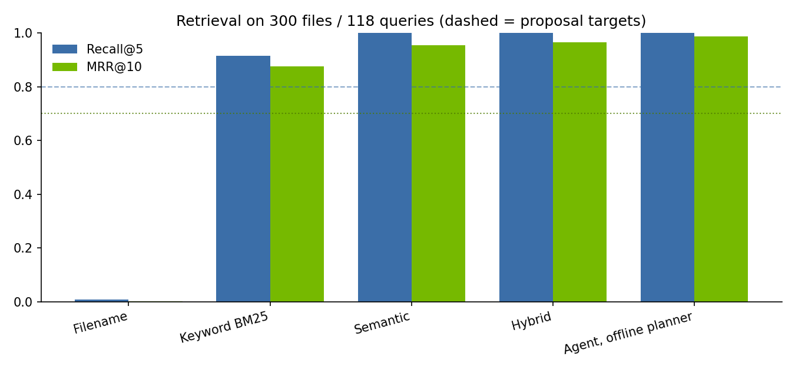

# Recall — find anything you saved, by what it *said*

Recall is a private search engine for the screenshots, photos and PDFs on your own computer.
Ask in plain language — *"when is my machine-learning exam?"*, *"wifi password at grandma's"*,
*"the Starbucks receipt from September"* — and get the file, the exact lines that matched, and a one-click way
to open the original.

* **On-device by default.** OCR (PP-OCRv5, ONNX), text embeddings (bge-small, ONNX) and the index (SQLite + FTS5)
  all run locally, on CPU or an NVIDIA GPU. Your files never leave the machine.
* **Agentic search with NVIDIA Nemotron.** A Nemotron model on **Nebius Token Factory** reads *only your query*
  and turns it into a search plan: rewritten semantic query, synonyms, file-type and date filters. Recall then
  judges its own results and re-plans when it is not confident.
* **Verifiable privacy.** Every byte sent off-device is logged in a *Privacy ledger* tab with its exact payload.
  Sending file snippets (to get a direct answer like *"Oct 23, 10:30, Room 301 [1]"*) is a separate opt-in toggle.

Built for the **Nebius × NVIDIA Global AI Hackathon 2026 — Personal AI track**.

## How it works

```
 your folder ──► extract ──► chunk ──► embed ──► SQLite (metadata + FTS5 + vectors)        ── all local
                 PP-OCRv5      700ch    bge-small
                 PyMuPDF (+OCR for scanned pages)

 query ──► Nemotron planner ──► hybrid retrieval ──► confident? ──no──► Nemotron re-plan ──► retrieve again
           (query text only)     cosine + 0.05·BM25     top cos ≥ 0.62      (synonyms, relax filters)
                                 + type/date filters        │yes
                                                            ▼
                                           ranked files + evidence lines (+ optional grounded answer)
```

| Component | Choice | Why |
|---|---|---|
| OCR | RapidOCR, PP-OCRv5 English recognizer (ONNX) | keeps word spacing; the default Chinese model glued English words together and cut keyword recall |
| Embeddings | `BAAI/bge-small-en-v1.5` via fastembed (ONNX) | 130 MB, fast on CPU, CUDA when available |
| Keyword | SQLite FTS5, BM25, Porter stemming | exact identifiers: course codes, store names, booking refs |
| Fusion | cosine + 0.05 × max-normalised BM25 | weight picked on a separate dev corpus (see *Evaluation*) |
| Planner / agent | NVIDIA Nemotron on Nebius Token Factory (OpenAI-compatible API) | date reasoning (*"from September"*), synonyms, retry strategy |
| Offline fallback | deterministic rule planner | the app is fully usable with no key and no network |
| UI | Streamlit | indexing, search, evidence, open/download, privacy ledger |

## Quick start

```bash
git clone <this repo> recall && cd recall
./setup.sh                 # GPU build if nvidia-smi works, CPU build otherwise (./setup.sh cpu to force)
# put your key in .env  ->  NEBIUS_API_KEY=...   (https://tokenfactory.nebius.com)
.venv/bin/streamlit run app.py
```

Command line:

```bash
.venv/bin/python -m recall index ~/Pictures/Screenshots
.venv/bin/python -m recall search "when is my OS midterm?" --answer
.venv/bin/python -m recall models          # Nemotron models visible to your key
```

Settings (`.env` or environment):

| Variable | Default | Meaning |
|---|---|---|
| `NEBIUS_API_KEY` | — | enables the Nemotron planner; without it Recall runs 100 % offline |
| `NEBIUS_MODEL` | auto | pin a Nemotron model id; auto picks a Nemotron *Nano* if available |
| `RECALL_DEVICE` | `auto` | `cuda` / `cpu` |
| `RECALL_WORKERS` | auto | OCR processes while indexing (2 on GPU, half the cores on CPU) |
| `RECALL_HOME` | `~/.recall` | where the index lives |

## Evaluation

Real personal files cannot be published, so `eval/make_dataset.py` generates a reproducible corpus of
screenshots (phone, web, slides), receipts, boarding passes, chat messages, digital and **scanned** PDFs,
text-free photos and exact duplicates. Filenames are realistic and uninformative (`Screenshot_20260912_141233.png`,
`IMG_4821.jpg`, `scan0003.pdf`). Each target file has a natural-language query that paraphrases its content
(e.g. *"when am I seeing the skin doctor"* for a *Dermatology* appointment) and some queries need date reasoning
(*"the Olive Young receipt from August"* when two Olive Young receipts exist).

```bash
.venv/bin/python eval/make_dataset.py --seed 7  --n 300 --out eval/data   # test corpus
.venv/bin/python eval/make_dataset.py --seed 11 --n 150 --out eval/dev    # dev corpus (tuning only)
.venv/bin/python eval/tune_hybrid.py                                       # pick hybrid weight on dev
.venv/bin/python eval/run_eval.py --reindex                                # report on test
.venv/bin/pytest -q                                                        # functional + privacy tests
```

### Results — test corpus (seed 7): 300 files, 118 queries, CPU only

| Method | Recall@5 | MRR@10 | Hit@1 | Mean latency |
|---|---|---|---|---|
| Filename (what OS search does) | 0.008 | 0.002 | 0.000 | 2 ms |
| Keyword (BM25 over OCR text) | 0.915 | 0.876 | 0.839 | 1 ms |
| Semantic (embeddings) | 1.000 | 0.955 | 0.915 | 12 ms |
| Hybrid (semantic + 0.05 BM25) | 1.000 | 0.966 | 0.932 | 13 ms |
| **Agent, offline planner** | **1.000** | **0.987** | **0.975** | 10 ms |

| Proposal target | Goal | Measured |
|---|---|---|
| Recall@5 | ≥ 0.80 | **1.000** |
| MRR@10 | ≥ 0.70 | **0.987** |
| OCR extraction success (token recall ≥ 0.9) | ≥ 90 % | **100 %** of 232 text files (mean token recall 0.998); 38/38 text-free photos correctly empty |
| Search response time | ≤ 3 s | **13 ms** p95 20 ms (hybrid); agent adds one Nemotron round-trip |
| Functional tests | ≥ 95 % pass | **9/9** (`pytest`) |
| Unintended transmissions | 0 | **0** socket attempts with networking blocked |
| Duplicate detection | — | 30/30 |

Engineering findings worth knowing:

* **OCR model choice mattered more than the retriever.** The default RapidOCR (Chinese PP-OCR) dropped spaces
  between English words (`ClosedbookBringstudentID`). Switching to the PP-OCRv5 English recognizer raised OCR
  success from 44 % to 100 % and keyword Recall@5 from 0.72 to 0.92.
* **Rank fusion hurt.** Reciprocal-rank fusion of BM25 and embeddings scored *below* pure semantic (noisy OR-queries
  flood BM25). A small max-normalised BM25 bonus (weight 0.05, chosen on the dev corpus: Recall@5 1.000,
  MRR@10 0.977 vs 0.955 without it) fixes this.
* **Honest caveat:** the synthetic corpus is now saturated at Recall@5 = 1.0 and shares templates with the dev
  corpus, so it shows the pipeline works, not how it does on messy real data. A 1,000-file run and a small user
  study with consented real screenshots are the next evaluation steps.



## Privacy model

| Data | Leaves the device? |
|---|---|
| Files, thumbnails, OCR text, embeddings, index | **Never** |
| Your query text | Only in Agent mode with a key: sent to Nemotron on Nebius Token Factory to build the plan |
| Top-3 matching snippets | Only if you switch on *"Let Nemotron read the top 3 snippets"* |

`tests/test_recall.py::test_no_network_during_indexing_or_offline_search` blocks every socket and checks that
indexing and offline search still work with **zero** connection attempts. The in-app *Privacy ledger* shows
every outbound request verbatim.

## Limitations and next steps

* The synthetic corpus is English; Korean/multilingual OCR + a multilingual embedder is the next step.
* Query intent, not the user's history, drives the planner; learning from clicked results is future work.
* Search results are per file; very long PDFs are capped at 50 pages per file.

## License

MIT — see [LICENSE](LICENSE).
